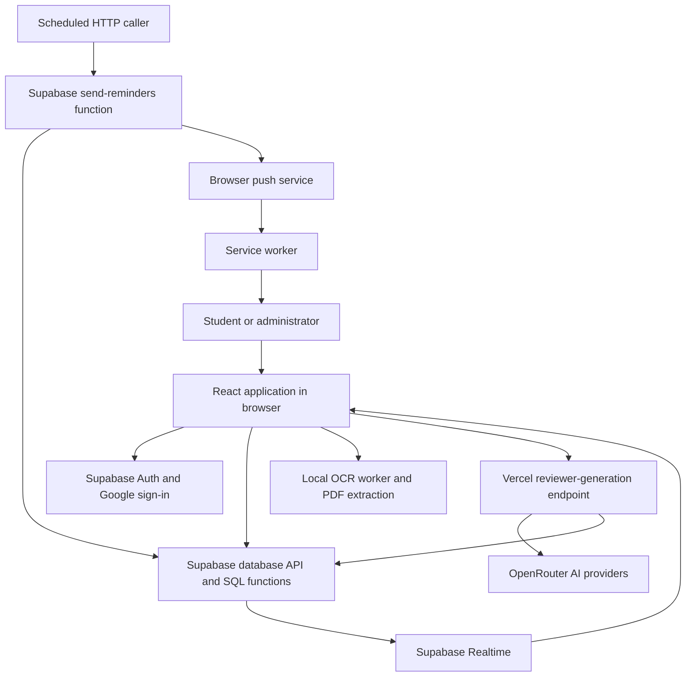
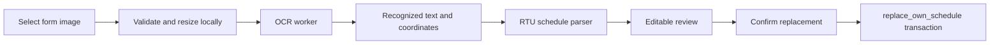
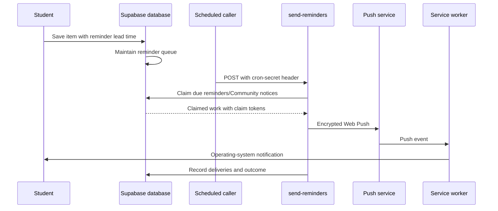

# Cali: an end-to-end technical guide

This guide explains the local codebase as inspected on October 16, 2026. It describes what the code does; it does not confirm the current state of a live Vercel deployment, Supabase project, cron service, or AI provider. Deployment notes in other documents can describe an earlier version.

Read this alongside [Start here](start-here.md). You do not have to memorize every filename: learn a user journey, then follow its screen, helper functions, and database operations.

## Contents

1. [The architecture](#1-the-architecture)
2. [The technologies and vocabulary](#2-the-technologies-and-vocabulary)
3. [Startup, routing, and shared state](#3-startup-routing-and-shared-state)
4. [Authentication and onboarding](#4-authentication-and-onboarding)
5. [Dashboard](#5-dashboard)
6. [Schedules and schedule scanning](#6-schedules-and-schedule-scanning)
7. [Tasks](#7-tasks)
8. [Calendar](#8-calendar)
9. [Study: manual reviewers](#9-study-manual-reviewers)
10. [Study: AI reviewer generation](#10-study-ai-reviewer-generation)
11. [Study: flashcards](#11-study-flashcards)
12. [Study: quizzes](#12-study-quizzes)
13. [Community](#13-community)
14. [Administration and moderation](#14-administration-and-moderation)
15. [Profile, settings, and account deletion](#15-profile-settings-and-account-deletion)
16. [Reminders and notifications](#16-reminders-and-notifications)
17. [PWA and offline behavior](#17-pwa-and-offline-behavior)
18. [Database and security](#18-database-and-security)
19. [UI, styling, and browser behavior](#19-ui-styling-and-browser-behavior)
20. [Configuration, builds, and deployment](#20-configuration-builds-and-deployment)
21. [Debugging and verification](#21-debugging-and-verification)
22. [Learning and dividing the work](#22-learning-and-dividing-the-work)

## 1. The architecture

Cali is a single-page academic workspace. The browser renders its pages with React. Supabase provides Google authentication, a PostgreSQL database, database functions, and Realtime subscriptions. Vercel serves the built website and the AI reviewer endpoint. A separate Supabase Edge Function sends push notifications when called by a scheduled service.

There are several execution environments to keep separate:

| Environment | Code | Responsibility |
| --- | --- | --- |
| Browser main thread | `src/` except the OCR worker | Screens, forms, local state, data requests, editing |
| Browser worker | `src/lib/scheduleOcr.worker.ts` | Computationally expensive OCR away from the UI thread |
| Vercel Node runtime | `api/` and imported `server/` files | Authenticated AI generation using private credentials |
| PostgreSQL | `supabase/migrations/` | Durable data, access rules, transactions, quotas, queue logic |
| Supabase Deno runtime | `supabase/functions/send-reminders/` | Background push dispatch |
| Browser service worker | `public/sw.js` | Receive push, open destinations, cache OCR assets, show offline navigation page |

For most features, the browser talks directly to Supabase. A separate Express server is not required. The database functions are a substantial part of Cali's backend, even though they are SQL rather than TypeScript.

Three common request paths explain most of the application:

1. **A normal read:** page opens -> Supabase table query or SQL function -> rows return -> React state updates -> screen renders.
2. **A protected multi-record write:** form submission -> browser validation -> SQL function -> ownership and input checks -> transaction commits -> response updates the UI.
3. **An external-service operation:** authenticated request -> server validates the user and limits -> external provider -> validated result -> database save -> response.

## 2. The technologies and vocabulary

These are the responsibilities of the packages configured in this repository, rather than a claim about the latest available versions.

| Technology | Meaning in Cali |
| --- | --- |
| React | Builds screens from components and rerenders them when state changes |
| TypeScript | Checks expected data shapes and function use before deployment |
| Vite | Runs the local development server and bundles the frontend for production |
| React Router | Chooses a screen from the URL without downloading a new HTML page for each navigation |
| Supabase client | Makes Auth, database, SQL-function, and Realtime requests |
| PostgreSQL | Stores records and runs the SQL rules and transactions |
| Tailwind CSS and custom CSS | Provide styling utilities, theme values, and page-specific layouts |
| Tiptap | Edits structured rich-text documents used by Study |
| PaddleOCR.js and ONNX Runtime | Recognize text from images locally using downloaded model files |
| PDF.js | Extracts selectable text from digital PDFs in the browser |
| `docx` | Installed dependency; no active import was found in the inspected application source |
| Web Push and VAPID | Let the background sender address browser subscriptions and authenticate push messages |
| Oxlint | Checks source code for suspicious patterns and rule violations |
| Sharp and Resvg | Generate or optimize image/icon assets during development |

Useful vocabulary:

- **Component:** a function that describes part of the screen. A page component can contain many smaller controls and dialogs.
- **State:** data React remembers for the currently mounted UI, such as the selected day or a form draft.
- **Prop:** a value passed into a component, such as the current student's ID.
- **Hook:** a React function such as `useState`, `useEffect`, or Cali's `useWorkspaceClock` that shares or manages behavior.
- **Context/provider:** a way to make shared values available throughout the component tree, such as the authenticated student or theme.
- **API:** an interface code calls to request work. Supabase's data API and Cali's AI endpoint are different APIs.
- **RPC:** remote procedure call. `supabase.rpc('cali_save_own_task', ...)` executes a named PostgreSQL function.
- **UUID:** a record identifier. Some are created in the browser before saving so retries reuse the same identity.
- **JSON/JSONB:** structured data. PostgreSQL JSONB columns hold document trees, cards, questions, and session snapshots.
- **Transaction:** a group of database changes that succeed or fail together.
- **RLS:** row-level security; database policies determine which records a caller can access.
- **Migration:** a versioned SQL change to the schema or its rules.
- **JWT/access token:** the signed credential sent with authenticated requests.
- **Revision:** a saved version number used to detect edits based on stale data.
- **Idempotency:** repeating a request without creating a second copy of its effect.

TypeScript validates the code's assumptions, but incoming network data still needs runtime validation. Browser validation helps a student correct a form; server/database validation protects stored data even if someone bypasses the UI.

## 3. Startup, routing, and shared state

Start with [`src/main.tsx`](../src/main.tsx) and [`src/App.tsx`](../src/App.tsx).

Startup proceeds as follows:

1. The browser loads `index.html`, whose root element receives the React application.
2. `main.tsx` imports global CSS, initializes sound behavior, and mounts React with `createRoot`.
3. `ThemeProvider` applies the user's theme preference.
4. `App` installs the router, error boundary, login-policy provider, authentication provider, and Community notification provider.
5. The authentication provider determines whether a session exists and whether the account can use Cali.
6. The router selects a page. Protected workspace pages wait for the Auth result before rendering their content.
7. After the window loads, the app registers the root service worker and requests an update check.

React's `StrictMode` enables additional development checks. Effects need appropriate cleanup because development can exercise setup and cleanup more than once.

### Route map

| URL | Purpose |
| --- | --- |
| `/`, `/login` | Landing page or redirect according to Auth state |
| `/auth/callback` | Sign-in callback handling |
| `/onboarding` | Complete an eligible account's student profile |
| `/access-denied` | Eligibility/suspension explanation |
| `/dashboard` | Today's overview |
| `/schedules` | Weekly classes and scanning |
| `/tasks` | Coursework planner |
| `/calendar` | Monthly calendar and private events |
| `/study` | Reviewers, flashcards, and quizzes; query parameters select internal views |
| `/community` | Shared reviewer discovery and workflows |
| `/community/reviewer/:reviewerId` | A specific shared reviewer |
| `/community/profile/:username` | A Community profile |
| `/profile` | Student profile and account controls |
| `/settings` | Notification and other settings |
| `/guide` | Student guide |
| `/admin/:section?` | Separate administration workspace |
| `/team` | Public team page |
| `/terms-and-conditions`, `/privacy-policy`, `/community-guidelines` | Public policy pages |
| Any unrecognized route | Not-found page |

The workspace wrapper contains the sidebar, mobile navigation, greeting, and selected module. Large modules are loaded with `lazy` and `Suspense`: the browser downloads their code when needed and shows a loading view while it arrives.

Not everything has its own file. Profile, settings, onboarding, several status screens, and the workspace layout live inside `App.tsx`. Search for component/function names there before assuming a file is missing.

State has three main lifetimes:

| Lifetime | Examples | What happens on reload |
| --- | --- | --- |
| React memory | Open dialog, form draft, selected card | Usually reset unless separately saved |
| Browser storage | Supabase session, theme, sound preference, AI intake recovery | Can survive reload on that browser |
| Database | Subjects, tasks, reviewers, saved study sessions | Loaded again after authentication |

A visible change is not necessarily saved. The save operation and its success/error handling determine durability.

## 4. Authentication and onboarding

Main files: [`src/lib/supabase.ts`](../src/lib/supabase.ts), [`AuthProvider.tsx`](../src/auth/AuthProvider.tsx), [`AuthContext.ts`](../src/auth/AuthContext.ts), and `LoginModeContext.tsx`.

### Sign-in journey

1. The public login-mode RPC returns whether personal Google login is allowed. If it cannot be read, the client defaults to disallowing it.
2. `startGoogleSignIn` calls Supabase OAuth with Google and a redirect to the current origin. It asks Google to show account selection.
3. The client uses the PKCE flow. Supabase handles the OAuth exchange and persists the resulting session.
4. `AuthProvider.reload` reads the local session, then calls `auth.getUser` to validate it with Supabase Auth. Reading local storage alone is not treated as enough.
5. `cali_access_status` determines eligibility, admin status, account type, and denial/suspension details.
6. For an eligible user, `cali_refresh_google_profile` refreshes identity-derived details and returns the student profile.
7. A complete profile produces `ready`; an incomplete profile produces `needsOnboarding`.

The policy supports verified Google identities. Institutional RTU accounts are the normal route, while the database has an admin-controlled setting for personal Google accounts and an admin allowance. Therefore, the current implementation is more flexible than a hard-coded browser check for `@rtu.edu.ph`.

### Auth state machine

| State | Application behavior |
| --- | --- |
| `loading` | Wait while the account is checked |
| `signedOut` | Offer login/landing page |
| `ineligible` | Show access-denied information |
| `needsOnboarding` | Require profile completion |
| `ready` | Render the workspace; expose admin navigation when authorized |
| `error` | Show a recoverable account-loading error |

Onboarding calls `cali_complete_onboarding` with username, program, and year level. Username syntax is lowercase letters, digits, and underscores, 3–30 characters; year level is 1–5. Identity-derived name and avatar come from trusted Google identity data rather than arbitrary browser form values.

The provider uses a request counter to ignore responses from older overlapping loads. Auth subscriptions are removed on cleanup. Token-refresh events do not trigger a full profile reload each time; the code avoids calling additional Auth methods synchronously inside the Auth-event callback.

Route guards improve navigation, but database checks enforce access. A student cannot become an administrator simply by entering `/admin` or altering React state. Suspension and policy enforcement must remain in SQL and privileged endpoints as well as the UI. Auth state is not continuously reloaded for every possible backend account change, so do not assume every open tab instantly reflects a policy change.

## 5. Dashboard

Main files: `WorkspaceContent` in `App.tsx`, [`DashboardSchedules.tsx`](../src/components/DashboardSchedules.tsx), [`DashboardTasks.tsx`](../src/components/DashboardTasks.tsx), and `src/lib/tasks.ts`.

The Dashboard is a view over existing schedule and task records. It does not maintain a second copy of the planner in another database table.

For classes, it loads the student's subjects and meetings, then computes the relevant class information against the current time. For tasks, it loads open tasks and checklist steps, then reuses the planner's ordering helpers. It displays the next unfinished step where available.

The date and greeting are derived in the browser. The workspace clock refreshes around minute boundaries and when visibility changes, allowing time-sensitive content to update without a page reload.

Quick actions navigate to URLs such as `/tasks?new=1`, `/study?new=manual`, and `/schedules?new=1`. The destination module reads the query parameter and opens its existing creation form. The Dashboard does not implement a second task editor.

When debugging a wrong Dashboard deadline, inspect the shared task/date helper first. When debugging missing data, inspect the corresponding subject/task query and its Auth/RLS context.

## 6. Schedules and schedule scanning

Main files: [`SchedulesPage.tsx`](../src/components/SchedulesPage.tsx), [`ScheduleScanner.tsx`](../src/components/ScheduleScanner.tsx), `scheduleOcr.ts`, `scheduleOcr.worker.ts`, `scheduleOcrProtocol.ts`, and `rtuScheduleParser.ts` under `src/lib/`.

### Data model

`schedule_subjects` stores subject-level details such as code, title, units, block section, owner, and color. `schedule_meetings` stores day, start/end times, room, reminder lead time, and the subject reference.

A subject can have several weekly meetings. A subject with no meetings can appear in Unscheduled. Keeping these separate prevents repeated subject details from being stored independently for each meeting.

### Manual creation and editing

1. Load the student's subjects, then their meetings.
2. Open the editor with an existing subject/meeting or a new draft.
3. Validate the fields and time range.
4. Create the subject if needed, then insert or update the meeting through Supabase table operations.
5. When editing shared subject details, update the subject record as well.
6. Refresh the displayed data after success.

This manual flow uses multiple requests with compensating cleanup. For example, it attempts to remove a newly created subject if meeting creation fails, and to restore meeting fields if a subsequent subject update fails. That is different from a single atomic SQL transaction: interrupted requests can still require refresh and recovery. The code includes messages for incomplete saves and refresh failures.

Deleting a subject removes its meetings through database relationships. Tasks that used that subject retain their task data and become unassigned/General. Do not interpret the meeting card's delete action as deleting only one visual occurrence when the confirmation describes subject deletion.

### Registration-form scanning

The scanner accepts JPG, PNG, and WebP. Limits are 12 MB, 20 million source pixels, and a 2,048-pixel maximum processing edge. It validates and prepares the image in the browser.

The worker initializes PaddleOCR with locally hosted PP-OCRv5 detection and English recognition model archives. ONNX Runtime executes the models using WASM. The main thread and worker exchange typed messages with request IDs; pending promises are resolved when the corresponding response arrives.

OCR produces text lines and their positions. `rtuScheduleParser.ts` applies deterministic rules to turn those lines into subjects and meetings. Recognition and parsing are separate stages: a correctly recognized line can still be interpreted incorrectly by the parser, and a parser cannot recover text that OCR failed to read.

The review step lets the student correct results. Missing required values block saving and point to the affected field. The reviewed payload goes to `replace_own_schedule`, which performs the replacement atomically. Original images and OCR output are not uploaded as files; the confirmed schedule data is what is saved.

The worker is reused for subsequent scans, released after five idle minutes, and destroyed/recreated after cancellation or failure. A shared initialization promise avoids starting multiple copies of initialization. Abort signals communicate cancellation. Stale deployment chunks can result in a reload recovery message.

`vite.config.ts` contains custom handling for PaddleOCR's nested worker and ONNX resolution. These are runtime integration details; simplifying them without tracing the worker build can break scanning even when the page renders normally.

## 7. Tasks

Main files: [`TasksPage.tsx`](../src/components/TasksPage.tsx), [`src/lib/tasks.ts`](../src/lib/tasks.ts), and `src/hooks/useWorkspaceClock.ts`.

### Data and views

`tasks` stores the title, notes, owner, optional subject, due date/time, planned date, priority, completion/status information, and reminder lead time. `task_steps` stores ordered checklist items linked to a task.

The UI presents Today, Upcoming, and Completed. Older status/position concepts remain in the model and helpers even though the main interface is a planner rather than a Kanban board. A filename or helper mentioning columns does not prove that a board is currently shown.

### Create/save journey

1. Open a draft with an initial UUID for a new task.
2. Validate the form: title, deadline, reminder requirements, notes, planned date, and checklist.
3. Call `cali_save_own_task` with task details and steps.
4. SQL checks account eligibility, ownership, linked subject ownership, and checklist validity.
5. Save the task and checklist in one transaction.
6. Apply the returned data and update/refresh the view.

Reusing the draft's UUID means retrying a creation does not invent a new task identity. The database operation is designed to handle the stable identity. This matters when the first request committed but its network response was lost.

Key browser limits include a 160-character title, 4,000-character notes, at most 50 steps, and a 240-character description per step. A reminder requires a due time and a valid lead time. Planned date cannot be after due date.

### Ordering and time

`plannerGroups` first separates overdue work, then non-overdue work due or planned today. If today's group is empty, it suggests up to three other open tasks. Within groups, the helper prioritizes in-progress state, then deadline, then importance, then creation time. The Dashboard reuses these rules.

A date-only task remains due through the end of its local calendar day. A task with a supplied time becomes overdue after that precise local deadline. `useWorkspaceClock` refreshes every 30 seconds and on focus/visibility return so overdue status can change while the page is open.

Completing the full task and checking a step are separate actions. Status changes use `cali_move_own_task`; step changes use `cali_set_own_task_step_complete`. Previewing a task does not mark its next step done. Deletion and whole-task completion use deliberate confirmation flows.

## 8. Calendar

Main files: [`CalendarPage.tsx`](../src/components/CalendarPage.tsx), `src/lib/calendarColors.ts`, and `src/styles/calendar.css`.

Calendar combines three kinds of data:

| Kind | Underlying source | Meaning |
| --- | --- | --- |
| Class | Subjects and weekly meetings | A repeated weekday occurrence |
| Task | Open tasks | A deadline on a particular date |
| Event | `calendar_events` | A separate private dated record |

It loads these sources and computes a monthly grid and selected-day details in the browser. The same class meeting can appear on several dates because the calendar expands its weekly rule; those cells are not separate subject records.

Private events have title, date, optional times, location, notes, color, and reminder information. Event creation uses a stable UUID and owner-scoped upsert, allowing retries to address the same new record. Editing and deletion operate on the event record.

After a successful save/delete, refresh is a separate step. If refresh fails, the UI should report that the operation succeeded but fresh data could not be loaded, rather than encouraging a duplicate creation.

Selecting a class or task directs the student to that item's owning module. The create menu can launch the existing task/class forms with date or weekday information prefilled. A Calendar event is edited in Calendar itself.

Subjects and events share named color presets with theme-specific values. Color is an attribute of the underlying subject/event; it is not an unrelated decoration stored separately for each calendar cell.

## 9. Study: manual reviewers

Main files: [`StudyPage.tsx`](../src/components/StudyPage.tsx), `src/lib/reviewers.ts`, `reviewerDocument.ts`, and `src/styles/study.css`.

Study contains three related tools: reviewers, flashcards, and quizzes. They share a workspace, but their saved records and study behavior are different.

A reviewer is a rich-text study document stored in `reviewers`. It has a title, owner, optional subject, structured content, plain text, revision, and timestamps, with Community-related metadata added by later migrations.

### Why content has two representations

Tiptap content is a JSON document tree: a document contains nodes such as paragraphs, headings, lists, tables, and text, with marks for formatting. Plain text is a convenient derived representation for search, previews, and related workflows. The structured JSON retains formatting that a plain string cannot express.

`reviewerDocument.ts` handles defensive document normalization and URL safety for rendered content. PostgreSQL validators also check supported structure. Editor content, shared content, and AI output all need these boundaries because a type assertion cannot prove that stored JSON is well formed.

### Editing and autosave

1. Create a reviewer through `cali_create_own_reviewer`, then open its editor.
2. Tiptap changes update an in-memory draft and mark it dirty.
3. After roughly 1.2 seconds of inactivity, the save path calls `cali_update_own_reviewer` with the expected revision.
4. SQL verifies the revision and ownership, writes the content, and advances the revision.
5. The client records the saved revision. Edits made during the save remain dirty for the next save.

The editor shares one in-flight save promise rather than launching overlapping saves. Done saves before closing. A failure exposes retry controls, and leaving with unsaved changes can require Save and leave or a discard decision.

A stale expected revision is a conflict: another saved version exists. The reviewer RPC uses application error `P0001` for this case, and this editor does not blindly retry it as a transient database failure. Revision checking reduces lost updates; it does not merge two people's paragraphs automatically.

The module supports duplication through `cali_duplicate_own_reviewer`. Although `docx` is installed, no active application import was found, so its presence does not establish a Word-export feature. The files named `reviewerPdf.ts` and `reviewerPdfText.ts` implement PDF **input extraction** for AI intake; do not infer PDF export behavior from their names.

## 10. Study: AI reviewer generation

Main files: the intake in `StudyPage.tsx`; `noteScanner.ts`, `reviewerPdf.ts`, `reviewerPdfText.ts`, `reviewerPreferences.ts`, and `reviewerRecovery.ts`; [`api/study/reviewer-generation.ts`](../api/study/reviewer-generation.ts); and the three files under `server/`.

### Phase A: acquire and review source text

The student chooses one digital PDF or 1–10 photographed note pages. There is no separate pasted-text intake path. Photos use the same local OCR infrastructure as schedule scanning, but note lines are ordered and combined as text rather than parsed into subjects.

Digital PDFs are read locally by PDF.js. Text fragments are grouped into rows by position, sorted into reading order, and common page-number markers at the edges are removed. This is a deterministic extraction heuristic, so complicated layouts can still need correction. Password-protected, damaged, or textless material is rejected. A PDF with pages lacking selectable text is rejected rather than silently ignoring those pages.

| Input | Limit in the code |
| --- | --- |
| Note photos | 1–10 images; image limits inherited from OCR |
| Digital PDF | One file, up to 20 MB |
| Extracted source | 100,000 characters, including labels and whitespace |
| PDF page count | No separate fixed cap; extracted-text limits still apply |

The student checks the extracted text, then chooses detail and structured preferences such as examples, comparisons, memory aids, practice questions, and presentation style. The human-facing Quick/Balanced/In depth choices correspond to internal concise/standard/detailed values.

Original image/PDF files remain local. The reviewed **text and preferences are sent to Cali's server and the AI provider**, so local file processing does not mean the entire generation process stays on-device.

### Phase B: authenticate and reserve the request

1. The browser creates/reuses a request UUID and POSTs JSON to `/api/study/reviewer-generation` with its bearer access token.
2. The endpoint enforces POST, bounds the request body to 500,000 bytes, parses the input, and checks configuration.
3. It validates the token with Supabase Auth, requires a confirmed Google identity, calls the eligibility RPC, and checks that a student profile exists.
4. A private service-role client calls `cali_reserve_reviewer_generation`.
5. The reservation records the request identity and a hash of its relevant input, checks the monthly quota and active-request restriction, and handles duplicate submissions.

A previous successful request with an existing draft can return that draft. A request already processing produces an active-request response. Reusing a request ID with incompatible input is not treated as a fresh unrelated request.

### Phase C: generate and validate

`server/reviewerGeneration.ts` defines input parsing, prompts, output schema, structural validation, preference compliance, and conversion to Tiptap. `reviewerProvider.ts` orchestrates provider calls and deadlines. `reviewerPolicy.ts` defines the contextual academic-policy decision format and messages.

The provider flow checks source policy, requests a structured reviewer, validates its structure and semantic requirements, and checks output policy before accepting the result. The primary request uses strict JSON-schema output; the fallback uses JSON-object output and receives validation feedback. Calls have bounded attempt deadlines inside the endpoint's 110-second budget; the Vercel function is configured for a 120-second maximum.

Configured defaults in `server/reviewerGeneration.ts` select free model IDs. `CALI_REVIEWER_MODELS` can supply two to four distinct `:free` IDs. These are configuration choices, not proof that the external provider currently has those models available or that generation will always succeed.

The policy is contextual: academic discussion of sensitive topics is treated differently from abusive or nonacademic instructions. Source text is treated as untrusted data, not as permission to override system instructions. Unavailable or malformed policy checks fail the operation. Provider moderation remains fallible, so generated academic content still needs student review.

### Phase D: temporary draft, save, discard, and recovery

1. A valid result is converted to Tiptap JSON and plain text.
2. `cali_complete_reviewer_generation` stores a temporary draft and completes the generation request.
3. The UI shows the draft for editing. This is not yet a permanent library reviewer.
4. `cali_save_own_generated_reviewer` explicitly moves the accepted result into the student's saved reviewers.
5. Discard removes the temporary draft. Unsaved drafts expire after 24 hours.

Each eligible account is limited to 10 successful generations per calendar month, using the Manila time zone for the month boundary, and one active generation at a time. Successful generations count even when the student discards the output; failed attempts do not count.

`reviewerRecovery.ts` stores account-scoped intake text, preferences, and request ID in browser local storage for up to 24 hours. It validates the recovery record before restoring it. Sign-out, deletion, and deliberate discard clear recovery. Source text is not persisted as source material in Supabase, although the generated document and request metadata are stored.

Error categories distinguish invalid input, expired/forbidden sessions, quota, another active request, provider capacity, timeout, policy rejection/unavailability, and invalid output. If completion might have committed before a database response was lost, the endpoint looks for the saved draft before marking the request failed.

## 11. Study: flashcards

Main files: [`StudySetsPage.tsx`](../src/components/StudySetsPage.tsx) and [`src/lib/studySets.ts`](../src/lib/studySets.ts).

`flashcard_sets` contains the set title, owner, optional subject/source reviewer, cards, progress, active session, and revision. Each card has an ID, rich-text front/back, and corresponding text fields. A source reviewer is a reference while authoring; it does not mean AI generated the cards.

The journey is:

1. Create a set, optionally selecting a saved reviewer as reference.
2. Author Front and Back content and save through `cali_update_own_flashcard_set` using a revision.
3. Start a sequential or shuffled session, optionally limited to cards still learning.
4. Build and save a session containing card IDs, current index, ratings, and start information.
5. Reveal an answer and rate recall. The internal ratings include `again`, `hard`, and `good`.
6. Save progress/session changes through `cali_save_own_flashcard_study`, using expected session identity/index to detect stale actions.
7. At completion, show remembered/still-learning counts.

Mastery is a simple rule: two consecutive `good` ratings produce a mastered card; another rating resets that streak. It is not a full spaced-repetition scheduling algorithm. Progress can persist across sessions, and content reconciliation removes stale progress when the relevant card content changes.

The set editor and reviewer editor do not have identical conflict handling. Flashcard/quiz editing includes limited revision retry handling after inspecting the latest record, whereas manual reviewers use the stricter save flow described earlier. Follow the actual editor's logic when investigating conflicts.

## 12. Study: quizzes

Quizzes use `StudySetsPage.tsx` and `studySets.ts` as well. `quizzes` stores authoring data; `quiz_attempts` stores individual active, completed, or abandoned sessions.

Questions support multiple choice or true/false, rich-text prompts, optional topics/explanations, choices with stable IDs, and a correct-choice ID. Draft questions can be incomplete, but only valid questions enter a session. The editor warns about incomplete draft content.

### Attempt journey

1. Select Practice or Test and optional question/choice shuffling.
2. `buildQuizSnapshot` creates the exact question/choice arrangement for this attempt.
3. `cali_start_quiz_attempt` starts a persisted attempt with that snapshot.
4. Answers and position are saved through `cali_save_quiz_attempt`.
5. Practice provides feedback and review behavior; Test withholds feedback until submission.
6. Completion goes through `cali_complete_quiz_attempt` and records results.
7. The detail page derives latest scores, missed questions, topic insights, and history from completed attempts.

The snapshot is important: editing or shuffling the quiz later must not silently alter the questions used to explain an old result. Answers reference choice IDs, not just visible letter positions.

Not sure uses a dedicated skipped-answer value, allowing review logic to distinguish uncertainty from a selected choice. Needs review builds practice from questions missed in the latest completed attempt. Restarting replaces/abandons the unfinished attempt after confirmation. Completed attempts are retained as immutable history; deleting the quiz cascades to its attempts.

Flashcards and quizzes are manually authored tools in this implementation. Neither requires an AI request to create or study a set. Because questions and correct answers are available to the client, this module is a study tool rather than a secure proctored examination system.

## 13. Community

Main files: [`CommunityPage.tsx`](../src/components/CommunityPage.tsx), [`src/lib/community.ts`](../src/lib/community.ts), and `CommunityNotificationsProvider.tsx`.

Community exposes selected reviewers to other authenticated, eligible users. It adds sharing and discovery to reviewer records rather than creating a separate unrelated document editor.

### Publication and discovery

The owner chooses private, preview, or public visibility through `cali_set_reviewer_visibility`, together with sharing metadata. Search calls `cali_search_community_reviewers`, with filters such as query, category, program, year level, visibility, creator, and sort order. A selected item is fetched through `cali_get_community_reviewer`.

| Visibility | Practical meaning |
| --- | --- |
| Private | Owner's private reviewer; unavailable as a normal shared item to others |
| Preview | Discoverable metadata; document body requires permission |
| Public | Shared document body is available to eligible Community users, subject to moderation/access rules |

The latest preview-hardening migration returns an empty document body when the caller lacks full access. It does not send a complete hidden body to the browser and merely blur it with CSS. That distinction protects short and single-node reviewers as well as long documents.

### Access, copying, and attribution

The actual access types are `read` and `copy`. Read permits viewing protected content; copy permits creating a separate editable reviewer. This is not a live collaborative edit grant to the owner's original document.

1. A viewer calls `cali_request_reviewer_access`.
2. The owner sees the request in the inbox and approves/denies with `cali_resolve_reviewer_access`.
3. Granted access is represented in `reviewer_access_grants`.
4. The owner can change or revoke a grant with the matching RPCs.
5. An authorized copy calls `cali_copy_community_reviewer` and creates a separate reviewer with lineage/attribution information.

`reviewer_contributors` and parent/root reviewer references track contribution lineage. Bookmarks in `reviewer_bookmarks` save a Community item for later discovery; bookmarking and copying are different operations.

### Reactions, activity, and notifications

Votes use `cali_vote_community_reviewer`, and use events use `cali_record_community_reviewer_use`. Daily usage records support activity totals. A vote is committed before the client sends a best-effort Realtime broadcast; a failed broadcast must not turn an already-saved vote into a failed action.

Notifications live in `community_notifications`. The client fetches paginated pages with unread counts, marks items read, archives them, and restores them. Realtime subscriptions update notifications/access-related UI while the app is open. Push delivery is a separate path through the reminder Edge Function.

Reports are about shared reviewer content in the active moderation flow. Some TypeScript unions and older SQL still mention profiles; later migrations narrow active behavior. Trace the latest function definition and reachable UI before assuming an older type lists currently allowed actions.

## 14. Administration and moderation

The `/admin/:section?` route lazy-loads the export from [`AdminDashboard.tsx`](../src/components/AdminDashboard.tsx), aliased as `AdminPage` in `App.tsx`. A separate `AdminPage.tsx` file also exists; its name alone does not make it the active route entry point.

Related files are [`AdminModerationPanel.tsx`](../src/components/AdminModerationPanel.tsx) and [`src/lib/admin.ts`](../src/lib/admin.ts).

| Section | Responsibility |
| --- | --- |
| Overview | User/content/report aggregates and actionable account signals |
| Moderation | Review reports and inspect/manage shared reviewer visibility |
| Users | Search/filter accounts and review suspension/enforcement context |
| System | Personal-Google login policy and audit history |
| Handbook | Explanations for administrators |

All privileged actions go through administrator-checked database functions, including overview/search, report resolution, content visibility, suspension, and system settings. The browser's admin flag controls presentation; it is not the source of authority for SQL execution.

A report can be dismissed or confirmed through a hiding action with an explanation. Shared content visibility and whole-account suspension are separate decisions. Report totals are advisory signals: automatic suspension is not the implemented policy. Enforcement cases connect decisions to reports and preserve notes/status history.

`admin_audit_log` records privileged activity. The system login switch updates `cali_system_settings`. Personal-account eligibility depends on this setting and related database checks, so changing only the landing-page wording would not change the actual login policy.

Admin dialogs use the shared modal infrastructure for cancellation, busy states, and focus restoration. A database failure should leave the operator able to inspect/retry without falsely announcing success.

## 15. Profile, settings, and account deletion

Profile and settings screens are inside `App.tsx`; the Auth provider owns their account operations. Shared controls include `ThemePicker`, `SoundSettings`, and `InstallCali`.

Profile updates normalize username, trim program/bio, validate limits, update the authenticated student's row, and replace the in-memory profile with the returned record. Google-derived identity fields are separate from editable profile details.

Theme preference is stored under `cali-theme` and can be light, dark, or system. `ThemeProvider` resolves it, updates the root `data-theme` attribute and browser theme-color meta tag, and reacts to system preference changes. Sound preference is stored locally by `sounds.ts`; sound initialization/listeners are tied to application startup and cleanup.

Settings includes push enable/disable/status behavior and troubleshooting information. Installation guidance reflects browser support, including the manual Add to Home Screen journey where needed. Browser preferences and installation state are device-specific; they are not the same as profile data stored in Supabase.

### Sign-out

Sign-out clears reviewer intake recovery, attempts to remove this browser's push subscription, and signs out through Supabase. Push cleanup is bounded so a hung optional operation cannot indefinitely prevent logout. Signing out does not delete saved academic records.

### Permanent deletion

After confirmation, the app calls `cali_delete_own_account`. The database function and foreign-key cascades remove account-owned data and the Auth user transactionally according to the migration-defined deletion contract. The frontend then performs best-effort local cleanup and local sign-out.

When adding a new user-owned table, inspect the latest deletion function and cascades. The cleanup contract must cover the new relationship; deleting only `students` in a browser request is not equivalent to deleting the account. Local cleanup explicitly removes some preferences/recovery and push state; it should not be described as a blanket wipe of all browser storage.

## 16. Reminders and notifications

Main files: `ReminderField.tsx`, `src/lib/reminders.ts`, [`pushNotifications.ts`](../src/lib/pushNotifications.ts), [`send-reminders/index.ts`](../supabase/functions/send-reminders/index.ts), `pushSafety.ts`, and `public/sw.js`.

### Register a device

1. The user enables notifications in a supported browser.
2. The browser asks permission and waits for a ready service-worker registration with bounded waits.
3. `pushManager` returns an existing subscription or creates one using the public VAPID key.
4. The client submits its endpoint and encryption keys through `cali_save_own_push_subscription`.
5. SQL validates the destination/key format, enforces account/device rules, and stores the subscription.

A subscription addresses a browser installation, not a student's email. The same account can have subscriptions on several devices. If database registration fails, the code attempts to unsubscribe the just-used browser subscription rather than presenting a misleading enabled state.

The form presets are no reminder, 30 minutes, 1 hour, 3 hours, or 5 hours before. Existing valid values can still be formatted by the helper. Tasks need an explicit time for a timed reminder.

### Queue and send journey

Database reminder functions/triggers maintain due work when records change. Recurring classes need a future weekly occurrence; they are not one permanently scheduled browser timer. Reminder SQL and displayed push timestamps use Manila-based scheduling conventions, while some planner display calculations use browser-local dates. This distinction matters when debugging from another time zone.

The repository documentation describes cron-job.org calling the function once per minute. The code itself requires an authenticated scheduled POST caller; its present live configuration was not checked for this guide. The Edge Function validates `X-Cali-Cron-Secret`, uses private server credentials, and claims up to 10 reminders and 10 Community notifications per invocation.

Claim tokens and expiring leases identify which invocation owns work. Delivery records track successful subscription-level sends; retries can avoid resending already-recorded deliveries. The sender rechecks whether the underlying item still exists, whether a task is completed, and whether an account is suspended before dispatching.

The sender validates push hosts, rejects redirects, bounds HTTP work, processes a limited number concurrently, handles temporary failures with delays, and deactivates expired subscriptions after relevant push-service responses. Database retry exhaustion and lease recovery prevent work from remaining indefinitely claimed. Recurring class reconciliation helps arrange the next occurrence.

This is resilient queue processing, not an absolute guarantee of exactly one visible notification. Browser/OS delivery and network failures can affect what the user sees, and a send can succeed before delivery-record persistence fails.

`public/sw.js` handles the push event, constructs the visible notification, and stores a destination URL with it. On click it focuses an exact matching window, reuses/navigates a suitable window, or opens Cali at the destination. Notification permission, focus mode, and device policies still affect presentation.

## 17. PWA and offline behavior

The manifest and icons let supported browsers install Cali as a Progressive Web App. It remains the same web application and backend; installation does not create a separate native data model.

The service worker skips waiting on install and claims clients on activation. The app checks for worker updates after startup. Vercel headers prevent long-lived caching of HTML and ensure worker/manifest revalidation.

Its caching scope is intentionally narrow:

| Resource | Service-worker behavior |
| --- | --- |
| Immutable `/ocr/v1/` assets | Cache-first after they are requested |
| Page navigation | Network request bypassing HTTP cache; offline page if it fails |
| Application API/database responses | No custom offline data cache |
| Selected images and extracted OCR | Not persisted by this service worker |
| Full academic workspace | No complete offline workspace support |

`ConnectionNotice.tsx` provides status while an already-open page loses/regains connectivity. The service worker's offline page covers failed navigation. A cached OCR model can save another download, but it does not let the student load/save the whole workspace without internet.

## 18. Database and security

The migration directory is an ordered history, not a set of interchangeable snippets. Later migrations can replace functions, remove earlier tables, or tighten policies. To understand current behavior, find all definitions of a function and read the latest applicable one.

### Main data domains

| Domain | Main tables |
| --- | --- |
| Identity/profile | Supabase `auth.users` / `auth.identities`, public `students` |
| Classes | `schedule_subjects`, `schedule_meetings` |
| Planner | `tasks`, `task_steps`, `calendar_events` |
| Study documents | `reviewers` |
| AI requests | `reviewer_generation_requests`, `generated_reviewer_drafts` |
| Flashcards | `flashcard_sets` |
| Quizzes | `quizzes`, `quiz_attempts` |
| Community access | `reviewer_access_requests`, `reviewer_access_grants`, `reviewer_contributors` |
| Community discovery/activity | `reviewer_votes`, `reviewer_usage_daily`, `reviewer_bookmarks` |
| Community messages/reports | `community_notifications`, `community_notification_deliveries`, `community_reports` |
| Push | `push_subscriptions`, `reminder_queue`, `reminder_deliveries` |
| Administration | `cali_system_settings`, `admin_audit_log`, `account_enforcement_cases`, `account_enforcement_case_reports` |

This is a map of principal domains, not a complete column-level schema export. Older `reviewer_ai_requests`/`reviewer_ai_drafts` definitions belong to earlier iterations and should not be confused with the current generation tables.

The Plaza migrations create an experimental domain and then move its tables into restricted `plaza_v1_archive`. There is no active Plaza route in `App.tsx`. Keep the migration sequence intact: a later reversion can depend on the earlier schema existing.

### How access is enforced

1. Supabase Auth establishes who the caller is.
2. RLS policies determine which rows that caller can select or change through table operations.
3. SQL functions add eligibility, ownership, role, and cross-record checks for protected operations.
4. Constraints validate structural relationships and valid values.
5. Vercel/Edge endpoints separately authenticate external-service operations before using privileged credentials.

A browser `.eq('user_id', studentId)` filter limits a query but is not a security boundary by itself. RLS must protect the same data against a caller who removes that filter.

`SECURITY DEFINER` functions can run with the function owner's privileges. That lets them perform tightly controlled transactions, but requires explicit caller checks, safe object references/search paths, and restricted execution grants. Do not expose an unrestricted service-role-style operation merely because it is wrapped in an RPC.

Foreign keys express ownership/parent relationships, cascades clean up dependent data, and indexes make common lookups and relationship checks practical. The audit reinforcement migrations add structural document checks, atomic task saves, push validation, queue recovery, and foreign-key indexes.

Public browser keys identify the project and work with RLS; they do not grant the service role's privileges. The service-role key can bypass ordinary row policies and therefore remains in server environments. Never put it in a `VITE_` variable.

## 19. UI, styling, and browser behavior

Most pages own both their UI markup and interaction logic. `src/lib/` often supplies types/pure calculations, but Cali does not enforce a separate controller/service file for every page. Some large components contain several editors and dialogs, which accounts for much of the source size.

Shared controls include `CaliSelect`, `CaliDateTimePicker`, `CalendarColorPicker`, `ReminderField`, `OnboardingDropdown`, `WorkspacePrimitives`, `ConfirmationIcon`, `StatusIcon`, and `CaliWordmark`. Reusing them keeps keyboard behavior, spacing, and visual states consistent.

`ModalBackdrop.tsx` renders a native `<dialog>` into `document.body` through a React portal. It opens with `showModal`, restores focus to the initiating control on cleanup, and prevents close actions while busy. This shared wrapper is used in administrative surfaces; other modules also have their own confirmation/dialog code, so inspect the actual page rather than assuming every dialog uses one wrapper.

CSS is layered: `index.css` establishes the base system and imports Tailwind; theme/shared workspace/modal styles affect many screens; page styles refine individual modules. `main.tsx` imports global modal/workspace normalization after the base stylesheet. When two rules have similar specificity, import order can change the visible result.

Responsive behavior includes a mobile sidebar, stacked forms/cards, scrollable modal content, and dedicated page rules. Theme variables resolve colors rather than treating dark mode as a single background swap. Loading skeletons, empty states, error states, and offline notices are part of the interface, not separate datasets.

`AppErrorBoundary` catches render-time component errors and offers reload recovery. It does not automatically catch every asynchronous promise rejection; event handlers and data-loading functions still need their own error handling.

The app uses browser APIs for service workers, notifications, audio, local storage, workers, and file processing. Their support/permissions can differ independently: Google login working does not prove Web Push or local OCR works on that device.

## 20. Configuration, builds, and deployment

### Environment variables

| Location | Variables | Purpose |
| --- | --- | --- |
| Browser build | `VITE_SUPABASE_URL`, `VITE_SUPABASE_PUBLISHABLE_KEY` | Connect the browser to Supabase |
| Browser build | `VITE_VAPID_PUBLIC_KEY` | Register browser push subscriptions |
| Vercel/local AI endpoint | `SUPABASE_URL`, `SUPABASE_ANON_KEY`, `SUPABASE_SERVICE_ROLE_KEY`, `OPENROUTER_API_KEY` | Authenticate/check users, manage generation records, call provider |
| Optional AI configuration | `CALI_REVIEWER_MODELS` | Override the configured free-model list |
| Reminder Edge Function | Supabase server credentials, `VAPID_PUBLIC_KEY`, `VAPID_PRIVATE_KEY`, `VAPID_SUBJECT`, `CALI_CRON_SECRET` | Read/claim work and send authenticated push |

The browser client accepts a legacy `VITE_SUPABASE_ANON_KEY` fallback, but the current build gate requires `VITE_SUPABASE_PUBLISHABLE_KEY`. Runtime fallback support does not remove the build-time requirement.

Vite embeds `VITE_` values in the built frontend. Updating a browser environment variable generally requires a new build. Vercel variables and Supabase Edge secrets belong to separate deployment environments; setting one does not automatically configure the other.

### Commands

| Command | What it does |
| --- | --- |
| `npm install` | Installs packages using the manifest/lockfile |
| `npm run dev` | Starts Vite development server |
| `npm run lint` | Runs Oxlint |
| `npm run build` | Validates environment, checks TypeScript, bundles frontend, inspects bundle/secrets/budgets |
| `npm run preview` | Serves built frontend locally; does not reproduce the full deployed backend |
| `npm run icons` | Generates icons from the master artwork |
| `npm run images:optimize` | Regenerates optimized image assets |
| `npm run verify:study-ai` | Exercises the configured live AI provider; requires credentials and makes external calls |

The automated test suite and runner were removed at the group's request. There is no current `npm test` command. Older audit/handoff test counts are historical.

### Build pipeline

`check-deployment-env.mjs` requires configured client/server variables, checks URL consistency and basic formats, and rejects secret-looking `VITE_` names. `tsc -b` checks the referenced browser, Vite-config, and server projects. Vite builds the frontend into `dist`. `check-client-bundle.mjs` checks for exposed server secrets and enforces configured compressed asset budgets.

Those TypeScript references do not constitute a full Deno Edge Function check. The reminder function imports Deno/npm-runtime dependencies and is deployed separately. Similarly, `verify:study-ai` is separate from the ordinary production build.

### Local and production request handling

`vite.config.ts` serves the AI route locally using development middleware and `ssrLoadModule`. In production, the file under `api/` runs as a Vercel Node function. Static `vite preview` alone does not install the development middleware.

`vercel.json` configures the Vite build, `dist` output, AI timeout, response headers, OCR compatibility rewrites, and the single-page route fallback. That fallback allows a direct browser visit to `/tasks` to load `index.html` and then let React Router select Tasks.

Security headers include CSP, frame restrictions, content-type protections, and referrer/permissions policies. The current CSP permits evaluation-related capabilities used by browser runtimes and allows broad HTTPS/WSS connections. Treat it as the policy present in this code, not proof of complete protection against all browser threats.

Deployment has independent moving parts: frontend/Node endpoint, database migrations/Auth settings, Edge Function/secrets, and the scheduled HTTP caller. A successful frontend deployment does not automatically apply SQL migrations or update the Edge Function.

Do not edit an already-applied migration to repair a live schema. Add a new migration so other environments can follow the same history. OAuth redirect URLs must match the origin used for local, preview, tunnel, or production sign-in.

## 21. Debugging and verification

Start from the symptom, then identify the execution environment involved.

| Symptom | First places to inspect |
| --- | --- |
| Login loop or access denied | Auth state, `cali_access_status`, identity eligibility, redirect URL settings |
| List empty despite expected records | Network response, user ID, RLS, selected filters, database project |
| Save fails | Form validation, request payload, SQL error, latest function signature/migrations |
| Save worked but old UI remains | Reload/refresh request and local state, separately from mutation result |
| Task becomes overdue at an unexpected time | `localDeadline`, supplied due time, browser time zone |
| OCR fails to start | Worker loading, `/ocr/v1/` assets, WASM/runtime build, browser support |
| OCR text is right but schedule is wrong | `rtuScheduleParser.ts` and review payload |
| AI rejects/does not finish | Endpoint HTTP status/category, quota/reservation, server configuration, provider response/deadline |
| Edits conflict | Expected revision/session position versus latest saved record |
| Shared reviewer body missing | Visibility, grant, owner state, moderation, latest preview policy |
| Notification missing | Permission/subscription, queue due time, cron call, claim/delivery records, push/OS settings |
| Direct page visit fails on hosting | SPA rewrite and deployment routing |
| CSS change has no effect | Imported stylesheet, selector specificity/order, theme, viewport |

Use browser DevTools Network to distinguish a request that was never sent from one rejected by the backend. Inspect Console for rendering/worker errors, and Application for service workers, local storage, caches, and manifest state. Avoid pasting tokens, student records, or environment secrets into shared debugging notes.

For a code change, run lint and build, then exercise the affected flow using disposable records. Check create, read after reload, edit, cancellation, validation errors, failure feedback, and deletion where applicable. For shared/admin work, use separate authorized accounts to verify allowed and denied access. For UI work, check both themes, phone/desktop widths, keyboard navigation, and dialog focus.

Build success proves that the configured checks passed. It does not establish that OAuth is configured correctly, every database migration is applied, push is delivered to a device, OCR reads a real form accurately, or an AI provider is currently available.

## 22. Learning and dividing the work

Use a vertical slice: one user action all the way to storage and back. For a task save, explain the form, `TaskDraft`, browser validation, `cali_save_own_task`, table changes, and success/error UI. Once that makes sense, the same reasoning applies to other modules.

A useful group split is:

| Area | Suggested responsibility |
| --- | --- |
| Account and shell | Auth, onboarding, navigation, profile, settings |
| Academic planning | Schedules, Tasks, Calendar, Dashboard |
| Study | Reviewers, local extraction, AI requests, flashcards, quizzes |
| Community and administration | Publication, access, moderation, enforcement |
| Infrastructure | Migrations, reminders, deployment, environment/build checks |

Combine areas according to group size. Coordinate changes to shared files and database contracts. A renamed RPC or altered task shape can affect several modules even if each person owns a different page.

For every module, be ready to answer six concrete questions: what the user does, which component handles it, which data it reads/writes, where validation and permissions are enforced, what happens on failure, and how you verified it. Those answers give your group a defensible understanding of Cali without memorizing every line.
